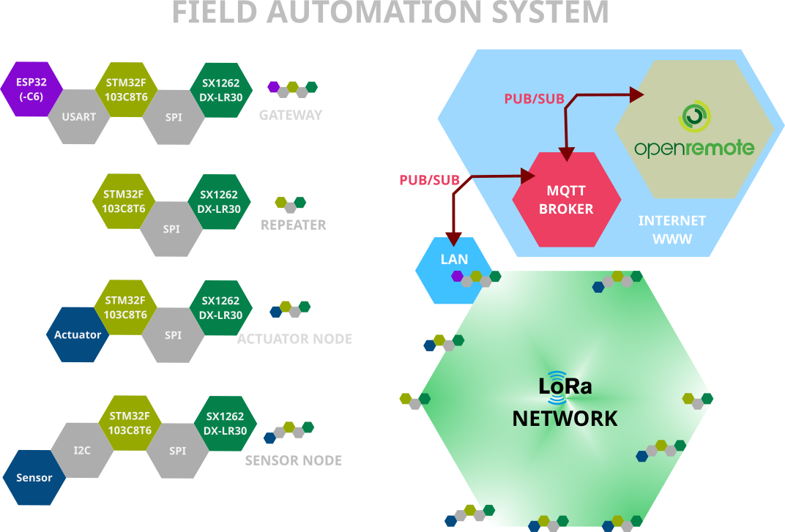

# LoRa Mesh Sensor & Relay Network (STM32 + ESP32-C6) 



A small 920 MHz LoRa mesh for battery sensors and relay control.
Every field device is an **STM32F103C8 (Blue Pill) + DX-LR30 (SX1262)** running one firmware;
an **ESP32-C6** bridges the mesh to an **MQTTS** broker (e.g. OpenRemote, Home Assistant).

```
Sensor Node ──LoRa──► Repeater ──LoRa──► Gateway (STM32 + ESP32-C6) ──MQTTS──► Broker
                                              ▲                                   │
                      Actuator (relay) ◄──LoRa┘◄──────── cmd/relay ───────────────┘
```

## Repository layout

```
.
├── README.md
├── esp32_gateway/     # ESP32-C6 gateway (ESP-IDF, PlatformIO)
└── stm32_dx-lr30/     # STM32F103C8 mesh firmware (Arduino/STM32duino, PlatformIO)
```

## STM32 firmware — `stm32_dx-lr30/`

One firmware image for all field devices. The role is detected at boot:

| Role | How it is selected | Purpose |
|---|---|---|
| Node | no jumpers | Low-power sensor, wakes on BMI160 motion or heartbeat |
| Repeater | PB0 → GND | Relays mesh packets |
| Actuator | PB1 → GND | Relay output with physical feedback input |
| Gateway | ESP32 answers UART PING | Forwards mesh traffic to the ESP32 and relay commands back |

Features: ACK + retry, hop-limited relaying with duplicate suppression, STOP-mode sleep on Nodes,
command queue and immediate status feedback on the Gateway/Actuator pair, CRC8-checked UART link.

Details, pin map and calibration checklist: [`stm32_dx-lr30/src/README.md`](stm32_dx-lr30/src/README.md)

```bash
cd stm32_dx-lr30
pio run -e bluepill_mesh -t upload
```

## ESP32-C6 gateway — `esp32_gateway/`

- Built on **ESP-IDF** (the Arduino framework is not supported for ESP32-C6 on PlatformIO).
- Answers the STM32's PING/PONG handshake right after boot, so the STM32 detects the Gateway role.
- Publishes node data over **MQTTS (TLS, username/password)** and subscribes to relay commands.
- Wi-Fi/MQTT settings are entered through an **AP-mode setup portal** and stored in NVS
  (nothing is compiled in).

| Topic | Direction | Payload |
|---|---|---|
| `<prefix>/<node_id>/data` | publish | JSON (heartbeat / motion, RSSI, SNR, accel/gyro) |
| `<prefix>/<node_id>/status` | publish | JSON (`commanded_on`, `feedback_pin_high`, ...) |
| `<prefix>/+/cmd/relay` | subscribe | `ON` / `1` = on, otherwise off |

Setup portal, Kconfig options and broker configuration: [`esp32_gateway/README.md`](esp32_gateway/README.md)

```bash
cd esp32_gateway
pio run -t menuconfig     # "Gateway Configuration"
pio run -t upload
```

## Wiring between the two MCUs

| STM32 | ESP32-C6 |
|---|---|
| PB10 (USART3 TX) | UART RX (set in Kconfig) |
| PB11 (USART3 RX) | UART TX (set in Kconfig) |
| GND | GND |

Do not connect the reset lines. The STM32 detects the Gateway by sending PING at boot, so the
ESP32 should start first (the STM32 retries 5 times).

## Important notes

- **No encryption or authentication on the LoRa link.** Anyone in radio range could forge a
  relay command. Do not use it for locks, safety-critical loads or unattended mains switching.
- **Regulations:** 920 MHz use is regulated (ARIB STD-T108 in Japan: certified module, carrier
  sense, transmit-time limits). Check the rules of your region.
- **Safety:** if you switch mains voltage with a relay, use proper isolation and a qualified
  installer.
- Boards with a CH340C auto-download circuit may fail to start after a reset when the PC serial
  port is closed. Power from a plain USB adapter, or power-cycle.
  
## Known limitations and future work

- **No encryption or authentication on the LoRa link.** A third party in radio range can forge
  a relay command. Do not use it for locks, safety-critical loads or unattended mains
  switching. Message authentication (e.g. HMAC with replay protection) is planned.
- The Node→Gateway ACK is hop-by-hop (confirms delivery to the adjacent node), not end-to-end
  (delivery to the Gateway).
- Repeaters relay only sensor packets (`MeshPacket`). Relay commands and their status replies
  are not relayed, so an Actuator must be within direct range of the Gateway.
- Sensor Nodes cannot receive downlink commands (they listen only briefly after transmitting).
- The radio is half-duplex. Packets can be missed while the Gateway is transmitting or waiting
  for an Actuator's confirmation; Nodes recover through their own ACK/retry.
- Flooding is limited by `hopLimit`, but if the node count grows substantially, consider stronger
  broadcast-storm countermeasures (e.g. introducing a routing protocol).
- Command sequence numbers restart from 0 when the Gateway reboots, and the Actuator does not
  verify the CRC of incoming command packets.
- Messages are published with QoS 0 and dropped while MQTT is disconnected; there is no
  store-and-forward buffering on the Gateway. Relay commands published while the Gateway is
  offline are lost, and no availability (Last Will) topic is published.
- The setup portal has no captive-portal DNS. Setup mode is entered on first boot, after a
  failed Wi-Fi connection at boot, or by a 5-second BOOT button press; it is **not** entered
  automatically when Wi-Fi is lost while running.

## License

MIT

## Credits

SX1262 driver based on https://github.com/NeutralSystem/STM32_DX-LR20_LORA
